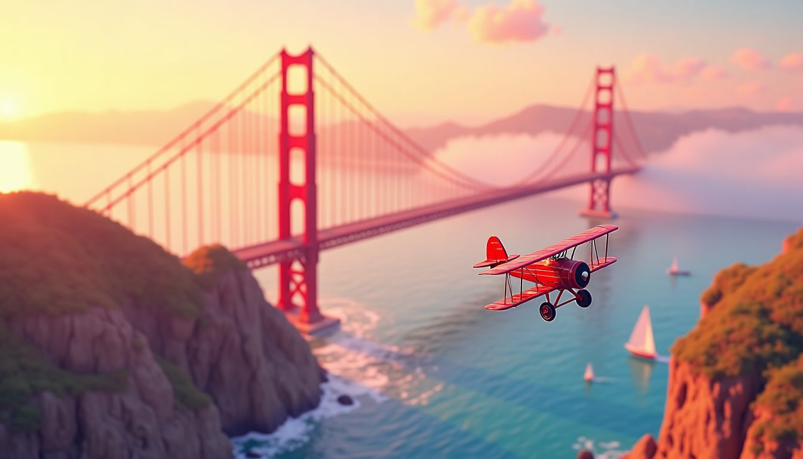
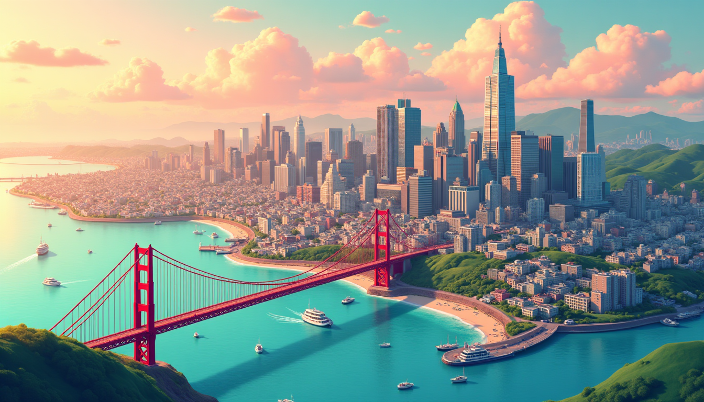
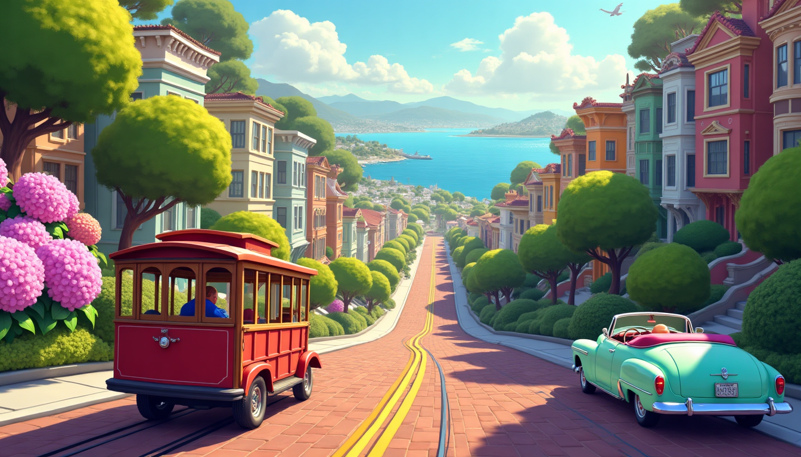
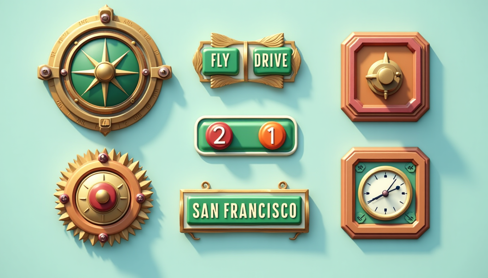
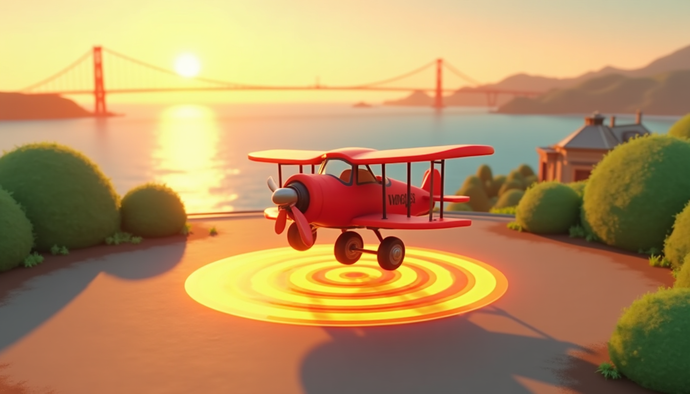
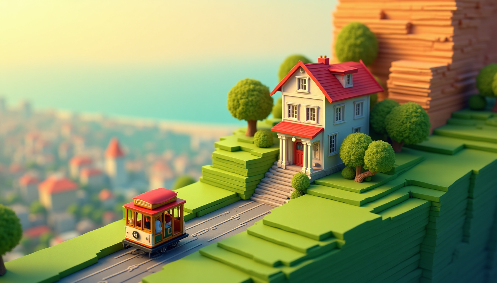
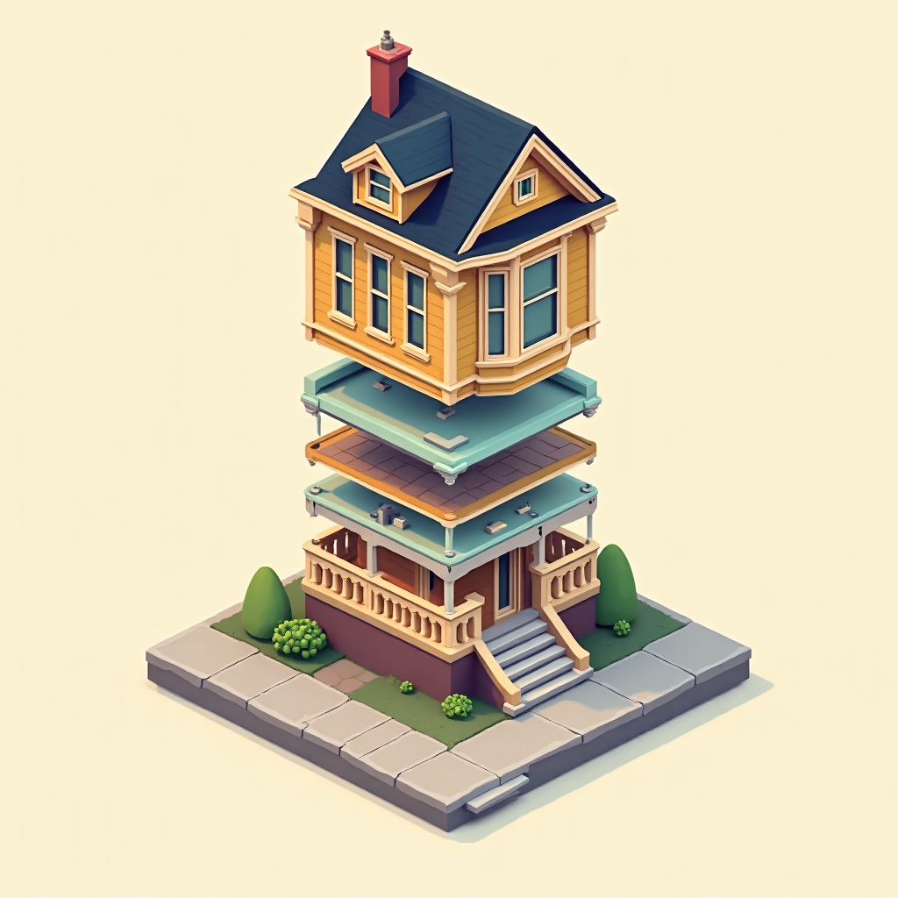
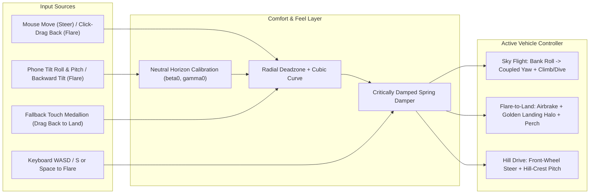
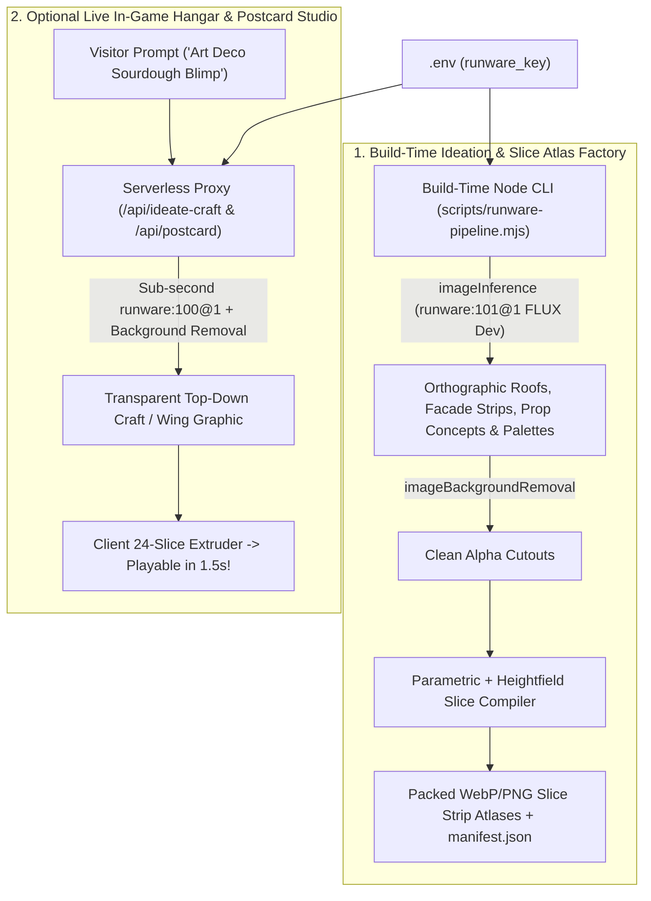

# Product Requirements Document (PRD): **SkyStack SF**
### *A 100% Sprite-Stacked Interactive Website & San Francisco Sky-to-Hill Playground*

> **Original Concept Seed**
> *"Make a beautiful website, using the whole interface based on sprite stacking, looking like you're in a game, flying around the San Francisco sky. Just be beautiful. I have Runware API key in env, so you can make up a lot of new images and ideations there. Just be beautiful, let us fly in San Francisco and maybe drive with mouse or phone tilt. And you can land on somewhere if you want to, by dragging with mouse or tilting backwards."*

---

## 1. Executive Summary & Creative North Star

**SkyStack SF** is an interactive, game-like web experience where **every single visual element—the San Francisco skyline, Golden Gate Bridge, undulating hills, volumetric fog, vehicles, typography, HUD instruments, buttons, and content modals—is rendered using real-time 2.5D Sprite Stacking**.

Instead of scrolling a flat webpage or slapping standard HTML/CSS menus on top of a 3D canvas, visitors immediately find themselves soaring through warm Pacific light over a handcrafted, living miniature diorama of San Francisco. Moving the mouse or gently tilting a phone banks their wings across the Golden Gate Strait, parts swirling banks of Karl the Fog, skims sparkling Bay whitecaps, flares gently onto scenic rooftops, overlooks, piers, or streets by **dragging back with the mouse or tilting the phone backward**, and cruises steep hills in a sprite-stacked Cable Car or vintage coastal convertible.

### Core Design Pillars ("Just Be Beautiful")
1. **Painterly Miniature Tactility**: Every building, vessel, cloud, and button is composed of $12$ to $96$ horizontal 2D cross-section slices stacked in Z-space. As the camera banks and orbits, subtle slice stepping, sunlit top caps, and warm ambient-occluded base layers create a cozy, tangible charm (*A Short Hike* × *Pilotwings* × *Studio Ghibli's coastal aviation scenes*).
2. **100% Sprite-Stacked Interface (Zero Flat Chrome)**: No flat CSS glassmorphism overlays. Navigation tabs are extruded San Francisco street signs; flight instruments are layered brass-and-enamel dials; buttons physically expand upward on hover and compress with a mechanical click when pressed; content sections open as tactile stacked vintage postcards.
3. **Effortless, Crash-Free Flow State**: Zero fail states, zero timers, zero steep learning curves. Within 0.5 seconds of page load, gentle cursor motion or phone tilt steers smoothly with critically damped spring physics and automatic horizon comfort stabilization.
4. **AI-Accelerated Art & Ideation via Runware**: Using the `runware_key` configured in `.env`, a dedicated Runware pipeline powers both **build-time visual ideation & sprite-slice asset synthesis** and an **in-game Hangar & Sky Postcard Ideation Studio** (via a secure server-side proxy).

---

## 2. Visual Ideations & Art Direction (Generated via Runware)

The concept plates below were generated directly using the workspace `runware_key` (`runware:101@1` FLUX.1 [dev]) to establish the target look, lighting, slice-stacking tactility, and UI language.

### 2.1 Hero Sky Flight — Golden Gate & Karl the Fog

*Target atmosphere: International Orange stacked towers rising through cotton-candy fog banks, shimmering cobalt water with layered foam wakes, warm apricot rim light, and lavender slice shadows.*

### 2.2 Axonometric San Francisco Skyline & Peninsula Diorama

*Compressed, joyful geography combining the Transamerica Pyramid, Coit Tower on Telegraph Hill, pastel Victorian hillsides, and the Bay Bridge into one cohesive, flyable miniature peninsula.*

### 2.3 Seamless "Hill Drive" Mode — Lombard & California Streets

*Swooping below rooftop altitude or flipping the `FLY ⇄ DRIVE` switch places players onto exaggerated 30° sprite-stacked San Francisco hills lined with hydrangeas, Painted Ladies, and panoramic Bay vistas.*

### 2.4 100% Sprite-Stacked Diegetic UI & HUD System

*Every UI widget is rendered as an extruded multi-slice object that tilts subtly toward the cursor/gyroscope to reveal its layered 3D side profile.*

### 2.5 Flare-to-Land & Scenic Perching Anywhere

*Dragging backward with the mouse or tilting the phone backward flares the wings into an airbrake descent, projecting a golden sprite-stacked landing halo onto any rooftop, hilltop plaza, street, pier, or Bay cove below.*

### 2.6 Stepped Horizontal Slice Contour Aesthetic (Close-Up)

*Close-up slice-stacking target: terraced horizontal contour plates with crisp inter-slice ambient occlusion shadows, turning San Francisco's cliffs, streets, cable cars, and houses into a living tabletop relief model.*

### 2.7 Sprite-Stacking Slice Anatomy & Playable Fleet
| Vertical Slice Decomposition | Playable Sky & Street Fleet |
| :---: | :---: |
|  |  |

### 2.8 Time-of-Day Color & Lighting Palettes
Players can scrub a sprite-stacked **Sundial Wheel** at any time to smoothly interpolate between four curated San Francisco moods:

| Palette Preset | Sky Zenith → Horizon | Bay Water Base / Foam | Top-Slice Sun Tint | Lower-Slice AO Shadow | Fog Tint ("Karl") |
| :--- | :--- | :--- | :--- | :--- | :--- |
| **Golden Hour (Default)** | `#3B6BA5` → `#FFB07C` | `#1C5D8C` / `#FFF3E2` | `#FFE0B2` (`1.12x`) | `#4A3B69` (`0.68x`) | `#FFD8C2` (Warm Rose-Gold) |
| **Morning Karl Mist** | `#7393B3` → `#DCE6F2` | `#396B89` / `#F4F8FB` | `#FFFFFF` (`1.05x`) | `#4D627A` (`0.75x`) | `#EEF4FA` (Dense Pearl) |
| **Crisp Pacific Noon** | `#1E78D6` → `#8FD3FF` | `#0E6BA8` / `#FFFFFF` | `#FFFBE6` (`1.10x`) | `#2C4975` (`0.72x`) | `#FFFFFF` (Light Wisps) |
| **Neon Bay Dusk** | `#161B33` → `#C85A7C` | `#12264A` / `#BCE3FF` | `#FF9EBB` (`1.08x`) | `#111328` (`0.58x`) | `#6B5B95` (Twilight Violet) |

---

## 3. World Design & Core Gameplay Loops

### 3.1 Stylized San Francisco World Map (`4096 × 4096` World Units)
Rather than sterile 1:1 satellite scale with miles of repetitive suburban grid, the map uses **Theme-Park Miniature Compression**—every 5 seconds of flight reveals an iconic San Francisco vista:

1. **Golden Gate Strait & Marin Headlands (Northwest)**:
   - Twin 96-slice International Orange suspension towers with catenary cable slices and moving tiny stacked cars on the deck.
   - Swoopable under-bridge clearance + tower slot gap; Fort Point brick arches below; dramatic ochre-and-sage Marin cliffs; red-roofed Point Bonita lighthouse.
2. **Downtown, Telegraph Hill & Embarcadero (Northeast)**:
   - **Transamerica Pyramid** (tapering 88-slice alabaster spire with wings), **Coit Tower** atop stacked eucalyptus trees on Telegraph Hill, **Ferry Building** clock tower with stacked palm boulevard, **Pier 39** wooden docks with barking stacked sea lions, and the **Bay Bridge** stretching east.
3. **Russian Hill, Nob Hill & Lombard Street (Center-North)**:
   - Dramatically exaggerated terraced sprite-stacked hills. Features the 8 crooked brick hairpins of **Lombard Street** bursting with pastel blue/pink hydrangea stacks, **California Street** cresting straight toward the Bay Bridge, and clanging cable car intersections.
4. **Alamo Square, Castro & Twin Peaks (South-Southwest)**:
   - The **Painted Ladies** pastel Victorian row facing a lush green park; **Castro Theatre** neon marquee blade; **Sutro Tower** rising 110 slices out of Twin Peaks cloud banks; Golden Gate Park Dutch Windmill on the western coast.
5. **San Francisco Bay & Alcatraz Island (Center-North Bay)**:
   - Layered rocky **Alcatraz** silhouette with water tower & lighthouse beam; bobbing sprite-stacked sailboats, red-and-white historic Bay ferries, container ships, buoy bells, and flocks of pelicans that bank alongside your wingtips.

### 3.2 Mode A: Sky Flight (Default Experience)
- **Immediate Drop-In**: The site opens mid-flight at 220m altitude on a gentle scenic orbit approaching the Golden Gate Bridge at Golden Hour, framed by the floating sprite-stacked **SKYSTACK SF** sky-title. Moving the mouse or tapping **"Take the Sky"** seamlessly hands control to the visitor.
- **Flight Envelope & Joyful Physics**:
  - **Cruising Speed**: `55 units/s`; **Cloud-Dash Boost**: `95 units/s` (spawns expanding sprite-stacked puff rings behind the tail).
  - **Hover / Snowglobe Orbit**: Holding Right-Click or tapping the stacked **Anchor/Hover** badge slows forward speed to `0` so visitors can lazily orbit the camera $360^\circ$ around any landmark to admire the stacked 3D slice parallax.
  - **Zero-Crash Floor & Water Skimming**: Flying within `12 units` of the Bay surface gently cushions vertical descent while kicking up dual ribbons of sprite-stacked whitewater spray and ripples. Grazing rooftops or bridge towers smoothly nudges the craft upward on a cushioned updraft.
  - **Volumetric Karl the Fog Interaction**: Fog banks are built from soft multi-slice alpha puffs (`16 slices` each) that radially part and swirl away from the player's wings as they slice through.

### 3.3 Mode B: Flare-to-Land & Scenic Perching ("Land Somewhere If You Want To")
Players are never locked in endless forward motion—at any moment they can pull into an **Aerodynamic Landing Flare** by **clicking-and-dragging backward with the mouse** or **tilting their phone backward**:
- **Airbrake Flare Feel**:
  - Pulling back pitches the aircraft's nose gently upward (`+16°` flare attitude), spreads the wings as an airbrake to bleed forward speed (`55 u/s → 8 u/s → 0 u/s`), and begins a cushioned, controllable vertical descent.
  - A warm **Sprite-Stacked Golden Landing Halo** (concentric rotating stacked rings + soft vertical light shaft) projects directly onto whatever surface lies beneath the landing trajectory, pulsing emerald-gold when over a level perch.
- **Three Landable Surface Classes Across San Francisco**:
  1. **Scenic Landmark Perches & Rooftops**: Coit Tower plaza, Golden Gate observation promenade & Fort Point courtyard, Alcatraz lighthouse plateau, Ferry Building waterfront, Pier 39 docks, Alamo Square grass park in front of the Painted Ladies, Marin Headlands cliffs, and flat downtown rooftop gardens. Landing triggers a springy slice-compression wheel bounce, settles the camera into a cozy panoramic vista framing, swells ambient SF soundscapes (foghorns, sea breeze, distant cable car bells), and raises that landmark's **Sprite-Stacked Postcard Plaque** nearby.
  2. **Streets & Hills (Organic Touchdown into Drive Mode)**: Flaring onto Lombard Street, California Street, the Embarcadero, or the Golden Gate roadway lets you taxi/roll straight along the hills or tap a stacked prompt to morph into the **Hyde St. Cable Car** or **'67 Convertible**.
  3. **San Francisco Bay Water Landing**: Flaring onto open Bay water automatically deploys tiny sprite-stacked seaplane pontoons so the plane bobs peacefully on layered water ripples alongside sailboats and pelicans.
- **Effortless Re-Takeoff**: Pushing/moving the mouse forward (or clicking Boost) or tilting the phone forward spins up the propeller and lifts smoothly back into the sky within 1.5 seconds.

### 3.4 Mode C: Street & Hill Drive ("Maybe Drive")
- **Seamless Mode Switching**:
  - **Flare-onto-Road Landing** (above) OR **Anywhere Toggle**: Clicking the chunky sprite-stacked `FLY ⇄ DRIVE` cockpit switch descends along a smooth 1.2-second landing arc onto the nearest scenic road spline/grid and swaps the player into a ground vehicle inside a whimsical burst of stacked cloud slices.
- **Playable Ground Vehicles**:
  1. **Hyde St. Cable Car**: Red-and-teak stacked classic with brass grip bell (`Space` / tap to ring *Ding-Ding!*).
  2. **'67 Pacific Convertible**: Pastel sky-blue open-top cruiser with responsive drift yaw around Lombard hairpins.
- **Arcade Hill Feel**:
  - Terrain elevation heightmap $H(x, y)$ tilts vehicle pitch visually via slice-offset shearing while shifting camera pitch slightly upward on ascents and dramatically downward when cresting hilltops—recreating that unmistakable stomach-flutter view down California Street toward the Bay.
  - Cresting steep intersections at boost speed gives playful, cushioned mini-airtime; driving off any pier ramp or clicking `FLY` immediately deploys wings and launches straight back into the sky.

---

## 4. Control Systems: Mouse, Phone Tilt, Flare-to-Land & Keyboard

All inputs feed into a unified normalized control vector `(steerX, pitchY, flareBrake, throttle, boost)` filtered through critically damped springs ($\zeta = 1.0, \omega_n = 8.5\text{ rad/s}$) so motion is **silky, responsive, and never twitchy**.

### 4.1 Desktop Mouse Controls (Steer + Drag-Back to Land)
- **Free Pointer Flight (No Button Pressed)**:
  - Normalized cursor position from viewport center $(dx, dy) \in [-1, 1]^2$ with an `8%` central deadzone and smooth cubic curve $\text{sign}(u) \cdot |u|^{1.6}$.
  - `dx` controls **Wing Bank Angle** ($\pm 42^\circ$) coupled smoothly into **Turn Rate (Yaw)** ($\pm 75^\circ/\text{s}$).
  - `dy` controls gentle **Climb / Dive Pitch** (cursor up = climb toward sky, cursor down = dive toward Bay).
  - **Pointer near HUD edges**: When cursor hovers over any sprite-stacked UI plaque/dock, flight steering gently dampens (`0.15x`) so clicking UI buttons never yanks the aircraft off course.
- **Click-and-Drag Backward to Land (`MouseDown + Drag Down/Back`)**:
  - Holding left mouse button and dragging downward/backward (`Δy_drag > 24px`, mapped cleanly to `flareBrake ∈ [0, 1]`) engages **Aerodynamic Flare**:
    - Bleeds forward airspeed smoothly toward hover/touchdown while projecting the **Sprite-Stacked Golden Landing Halo** beneath the plane.
    - Moving `dx` slightly during the drag nudges the aircraft laterally to line up dead-center on a rooftop pad, Coit Tower plaza, pier, or Lombard Street!
    - Releasing the drag before touchdown gracefully resumes cruising flight; holding until surface contact perches/lands cleanly.
- **Drive Mode**:
  - `dx` steers smoothly toward the cursor's heading relative to the vehicle; `Left-Click` / `W` / `Up` accelerates; `Drag Back` / `Right-Click` / `S` / `Down` brakes to a stop; `Scroll` zooms diorama elevation.

### 4.2 Mobile & Tablet Phone Tilt (`DeviceOrientationEvent` + Backward Tilt to Land)
- **iOS 13+ Permission & Calibration Flow**:
  - Modern iOS Safari requires `DeviceOrientationEvent.requestPermission()` inside a direct user tap handler.
  - On mobile load, while the camera performs a gorgeous automated Golden Gate flyover, a prominent tactile sprite-stacked **"Tilt Phone to Fly — Tap to Calibrate"** button floats center-bottom alongside **"Use Touch Stick"**.
  - Tapping **Tilt Phone to Fly** requests permission cleanly, captures the user's **initial 300ms averaged holding angle** $(\beta_0, \gamma_0)$ as neutral `(0, 0)`, and exposes a tiny one-tap stacked **Re-Center Gyro** badge in the top corner.
- **Tilt Mapping & Backward-Tilt Flare Landing**:
  - **Roll (`Δγ = clamp(gamma - gamma0, -30°, +30°)`)**: Maps smoothly to bank/turn (Sky), lateral landing alignment (Flare), or steering wheel angle (Drive), transformed across `screen.orientation.angle`.
  - **Cruise Pitch (`Δβ ∈ [-22°, +13°]`)**: Tilting top of phone forward (`Δβ < 0`) dives gently toward streets/water; slight backward tilt (`0° < Δβ ≤ +13°`) climbs smoothly.
  - **Backward-Tilt Landing Flare (`Δβ > +14°`)**: Tilting the phone further back toward yourself—like pulling back on control reins to slow down—smoothly engages `flareBrake = clamp((Δβ - 14°) / 14°, 0, 1)`:
    - Forward speed slows, nose flares up, the **Golden Sprite-Stacked Landing Halo** appears on the rooftop/hilltop/street/Bay below, and the craft glides gently down to land!
    - Once perched, tilting forward (`Δβ < -8°`) or tapping the screen smoothly takes right back off!
  - **Automatic Fallback**: On devices using the **Sprite-Stacked Virtual Flight Medallion**, dragging the thumbstick downward into its marked **LAND / BRAKE** bottom arc triggers the exact same flare-to-land descent.

---

## 5. 100% Sprite-Stacked Website Interface Architecture

To fulfill *"make a beautiful website, using the whole interface based on sprite stacking, looking like you're in a game"*, the site functions simultaneously as an **open-world toy** and an **effortlessly navigable showcase website**.

### 5.1 How the UI Stacking Pass Works
A dedicated orthographic **Screen-Space Sprite-Stacking Layer** renders over the world viewport using the exact same slice-extrusion shader:
- **Interactive Slice Tilt**: Every HUD widget has a local tilt vector $(\theta_x, \theta_y)$ driven by `(cursorPos - widgetCenter)` on desktop or `(Δγ, Δβ) * 0.25` on mobile (`±12°`), constantly showing off the colorful 3D stacked layers along the sides of buttons, dials, and frames.
- **Tactile Slice Physics**:
  - **Idle**: `14 slices` at `1.2px` vertical slice step + soft stacked drop-shadow (`4 dark translucent base slices` offset toward bottom-right).
  - **Hover / Focus**: Slice spacing springs from `1.2px → 1.85px` (`ω = 18, ζ = 0.65`), lifting the top face toward the user with a warm golden highlight.
  - **Active / Press**: Slice spacing compresses to `0.55px` with a crisp procedural wooden/brass click sound.

### 5.2 Diegetic UI & Website Navigation Components
1. **In-Sky Volumetric Stacked Hero Logo**:
   - Floating above the Golden Gate approach on arrival; crafted from 28 stacked golden-cream and terracotta slices. Flying straight through the letters scatters harmless golden cloud particles, or scrolling/clicking a landmark glides smoothly past it.
2. **Bottom "SF Street-Sign" Navigation Dock**:
   - Five extruded green-and-cream San Francisco street-name plaques (`Golden Gate`, `Skyline & Story`, `Lombard Drive`, `Hangar Studio`, `Postcards & Links`).
   - Clicking any plaque engages a **Scenic Autopilot Catmull-Rom Spline** (3.5 seconds, banking gracefully over the Bay) to that district and opens its **Sprite-Stacked Diorama Card**—allowing non-gamers to browse the entire website with single clicks while keeping manual flight interruptible at any moment!
3. **Cockpit Instrument Cluster (Corners)**:
   - **Top-Left**: Stacked Brass Compass Ring with live rotating 3D needle + Landmark Beacon pips.
   - **Top-Right**: **Sundial Time-of-Day Wheel** (Golden Hour / Karl Mist / Noon / Dusk) + Audio Chime Toggle.
   - **Bottom-Right**: Chunky mechanical **`FLY ⇄ DRIVE` Lever**, **Vehicle Cycler**, and **Boost / Snap Postcard** triggers.
4. **Sprite-Stacked Postcard Modals (Content Sections)**:
   - Approaching a glowing in-world **Sky Beacon Balloon** (or clicking a Street-Sign Dock tab) unfolds a **20-slice Vintage SF Postcard Frame** featuring:
     - Extruded wooden/ivory borders, a 3D stacked postage stamp in the corner, and a live rotating miniature sprite-stack of that landmark.
     - Crisp high-DPI typography & interactive links mapped seamlessly onto the top slice face (backed by a synchronized, invisible semantic HTML/ARIA shadow layer so links, copy-paste, `Tab` navigation, and screen readers work natively!).

---

## 6. Rendering Engine Architecture (60–120 FPS WebGL2 Sprite Stacking)

### 6.1 Why GPU Instanced Sprite Stacking (Not Canvas 2D)
Rendering a dense San Francisco skyline + volumetric fog + Bay traffic + stacked UI requires roughly **350–600 visible stacked objects × 32–64 slices = 15,000–30,000 slices per frame**. Naive `CanvasRenderingContext2D.drawImage` chokes above ~3,000 draws on mobile devices.

Using **WebGL2 Instanced Mesh / Custom `RawShaderMaterial` (Three.js or lightweight custom WebGL2)** packs shared assets into **Sprite-Stack Texture Atlases**, rendering **all 30,000 slices in < 8 draw calls at 60–120 FPS (< 2.5ms GPU time on iPhone/Android)**.

### 6.2 Projection & Sub-Slice Anti-Gapping Math
For an instance at world position $(X_w, Y_w, Z_w)$ with yaw $\psi$, scale $S$, slice count $N$, and sub-step multiplier $M = 2$ (rendering $N \cdot M$ quads so adjacent slices never separate into horizontal "venetian blind" gaps at low camera angles):

$$k = \left\lfloor \frac{\text{gl\_InstanceID}_{\text{local}}}{M} \right\rfloor, \quad z_{\text{slice}} = Z_w + \left(\frac{\text{gl\_InstanceID}_{\text{local}}}{M}\right) \cdot \Delta z \cdot S$$

1. **Horizontal Slice Rotation**: Each unit quad vertex $(u_x, u_y) \in [-0.5, 0.5]^2$ is rotated in the world XY plane by $(\psi - \theta_{\text{camYaw}})$.
2. **2.5D Tilted Camera Projection**:
   - Screen X: $x_s = x_{\text{camRel}} \cdot Z_{\text{zoom}}$
   - Screen Y: $y_s = -y_{\text{camRel}} \cdot \sin(\phi_{\text{pitch}}) \cdot Z_{\text{zoom}} + z_{\text{slice}} \cdot \cos(\phi_{\text{pitch}}) \cdot Z_{\text{zoom}}$
   - where $\phi_{\text{pitch}} \in [28^\circ, 62^\circ]$ dynamically tilts steeper in high-altitude overview and shallower (`28°–35°`) during dramatic low-level Golden Gate fly-throughs and Lombard hill crests!
3. **Per-Slice Shader Lighting & Karl Fog**:
   - **Vertical Ambient Occlusion**: Base slices ($k/N \to 0$) darken smoothly toward the active palette's shadow color (`mix(uShadowTint, vec3(1.0), smoothstep(0.0, 0.45, sliceRatio))`).
   - **Directional Rim Sunlight**: Finite-difference alpha neighbor taps in the slice atlas estimate the 2D horizontal slice outward normal $\vec{n}_{xy}$, adding warm golden sunlight along sun-facing slice edges!
   - **Height-Band Atmospheric Fog**: Blends distant and low-elevation slices smoothly into the active Pacific horizon haze.

---

## 7. Runware AI Integration & Asset Pipeline (`runware_key`)

### 7.1 Environment & Security Architecture
- The workspace `.env` provides `runware_key`.
- **Strict Security Rule**: `runware_key` is read **exclusively** in Node.js build/ideation scripts (`process.env.runware_key`) and the server-side API route (`/api/runware/*`). It must **never** be prefixed with `VITE_` or `NEXT_PUBLIC_` or shipped to browser client bundles.

### 7.2 Solving the "Diffusion → Coherent Sprite Stack" Challenge
Pure text-to-image models cannot natively output 64 pixel-aligned horizontal architectural cross-sections in one raw generation without slice jitter. SkyStack SF solves this cleanly via a **Two-Track Hybrid Compiler**:

1. **Track A — Landmarks & San Francisco Architecture (Parametric Cross-Sections + Runware Material/Detail Synthesis)**:
   - Runware (`runware:101@1`) generates crisp orthographic rooftop gardens, Victorian shingle textures, weathered brick hairpins, bay water foam patterns, and botanical canopy sprites (`imageInference` → `imageBackgroundRemoval`).
   - A deterministic Node slice builder (`scripts/build-stacks.mjs`) extrudes exact architectural silhouettes slice-by-slice ($z = 0 \dots N-1$)—such as the Golden Gate Bridge's Art Deco stepped tower cells and catenary cables, Transamerica's tapered pyramid + side elevator shafts, and Painted Ladies' bay windows and pitched gables—sampling the Runware textures, baking ambient occlusion, and packing everything into power-of-two **Slice Strip Atlases**.
2. **Track B — Organic Props, Clouds, Boats & Custom Player Flyers (Silhouette + Heightfield Extrusion)**:
   - Runware generates isolated top-down / orthographic sprites (`taskType: "imageInference"` followed by `taskType: "imageBackgroundRemoval"`).
   - Signed-distance-field (SDF) inward beveling + luminance height-mapping inflates the clean 2D alpha sprite into a lush, rounded `20–32 slice` 3D sprite stack (wings thinner at trailing edges, fuselage/blimp rounded across middle slices, cockpit canopy protruding on upper slices).

### 7.3 Live In-Game "Hangar & Sky Postcard Ideator"
Inside the **Hangar Studio** tab (backed by `/api/ideate` using `runware_key` with rate-limiting and prompt guardrails):
- **Dream Up a Flyer / Cruiser**: Visitors pick a chassis (*Biplane, Blimp, Glider, Cable Car*) and type a theme (e.g., *"Chinatown lantern dragon glider"*, *"Mission mural lowrider"*, *"matcha sourdough blimp"*). Runware `runware:100@1` (FLUX.1 Schnell) + `imageBackgroundRemoval` generates a custom transparent hull/wing sheet in **~1.2 seconds**, which the client slice-inflator turns into a **real, playable 24-slice sprite-stacked craft** you immediately fly over San Francisco!
- **Collectible SF Vintage Postcard**: Visitors frame a view over the Golden Gate or Lombard Street, click **Snap Postcard**, and optionally stylize/stamp it via Runware into a downloadable retro travel postcard.

---

## 8. Audio, Haptics & "Invisible Polish"

- **Procedural + Layered WebAudio Soundscape** (starts muted or starts softly on first interaction Gesture with a prominent stacked Mute chime):
  - **Flight Wind & Prop**: Filtered pink-noise wind rush whose cutoff frequency rises smoothly during dives and sharp wing banks; warm soft purr in biplane/convertible mode; zero harsh drone.
  - **Spatial SF Audio Landmarks**: Distant resonant *baaa-oooo* foghorn near the Golden Gate; rhythmic *clang-clang!* cable car bells over Nob Hill; barking sea lions near Pier 39; gentle lapping waves and seagull calls when skimming the Bay.
  - **Tactile UI Foley**: Warm wooden marimba/brass clicks when hovering and pressing sprite-stacked buttons.
- **Subtle Micro-Interactions**:
  - **Pelican Wingmen**: Flying steady for 4 seconds near the Bay invites 3 tiny sprite-stacked pelicans to form a V-formation off your wingtip!
  - **Boat Wake Reactivity**: Skimming low over sailboats makes them bob gently on stacked water rings.
  - **Lombard Flower Petals**: Drifting around Lombard Street hairpins kicks up tiny pastel hydrangea petals.

---

## 9. Non-Functional Requirements, Performance & Accessibility

| Category | Target Requirement |
| :--- | :--- |
| **Frame Rate** | Locked **60 FPS** on mid-range iOS/Android mobile devices; **120 FPS** on ProMotion / desktop displays. |
| **Initial Load Budget** | `< 1.5s` First Interactive Sky Frame on broadband (`< 4 MB` initial compressed slice atlases; secondary district props stream progressively). |
| **Draw Calls** | `<= 12` WebGL draw calls per frame (World Terrain + Landmarks Atlas + Vehicles/Props Atlas + Fog/Water Pass + Stacked UI Pass). |
| **Accessibility** | Hidden semantic DOM mirror (`<nav>`, `<button>`, `role="dialog"`) synchronized with stacked UI hitboxes; full keyboard flight/navigation; `prefers-reduced-motion` reduces bank roll angle by `65%` and disables camera FOV zoom pulses. |
| **Responsive Layout** | Full-bleed viewport (`100dvw × 100dvh`) across ultra-wide desktop, standard laptop, tablet, and mobile portrait/landscape with safe-area-inset padding for stacked corner HUD dials. |

---

## 10. Phased Implementation Roadmap & Acceptance Criteria

### Phase 1 — Core Sprite-Stacking Engine & Flight Feel
- Scaffold Vite + TypeScript + WebGL2 (Three.js custom instanced slice shader or dedicated lightweight WebGL2 stack renderer).
- Implement sub-stepped instanced slice rendering (`M = 2` anti-gapping), per-slice AO/sunlight shader, and dynamic pitch/yaw camera.
- Deliver silky Desktop Mouse Flight + Mobile `DeviceOrientation` Tilt (with iOS calibration flow + fallback virtual thumbstick).

### Phase 2 — San Francisco Diorama World & Runware Asset Compiler
- Build `scripts/runware-pipeline.mjs` consuming `runware_key` from `.env` (`imageInference` + `imageBackgroundRemoval` + parametric slice compiler).
- Populate the 5 SF districts: Golden Gate Bridge & Marin Headlands, Downtown (Transamerica, Coit Tower, Ferry Building, Bay Bridge), Lombard & California St. terraced hills, Painted Ladies & Sutro Tower, Alcatraz & Bay vessels, plus interactive Karl the Fog banks.
- Implement the 4 dynamic Time-of-Day palettes (Golden Hour default).

### Phase 3 — 100% Sprite-Stacked UI & Scenic Website Navigation
- Build the Screen-Space Orthographic Sprite-Stacking UI pass with cursor/gyro tilt parallax, hover slice expansion, and click compression.
- Ship the Floating Stacked Sky Title, SF Street-Sign Navigation Dock (with Catmull-Rom Autopilot camera tours), Brass Compass, Sundial Wheel, and Sprite-Stacked Postcard Modals with semantic ARIA mirroring.

### Phase 4 — Hill Drive Mode, Live Runware Hangar Studio & Audio Polish
- Implement `FLY ⇄ DRIVE` seamless swoop transition + steep SF hill terrain following for the Hyde St. Cable Car and '67 Convertible.
- Add backend proxy route (`/api/ideate`) powered by `runware_key` for custom Hangar flyer skin generation & SF Postcards.
- Layer spatial WebAudio soundscape, pelican wingmen, water-skim wakes, and mobile performance profiling.

### Definition of Done (Acceptance Criteria)
- [ ] **100% Stacked Interface**: Zero unstacked flat HTML chrome visible; every button, dial, sign, and postcard modal renders with visible multi-slice depth and responds to hover/press/tilt.
- [ ] **Effortless San Francisco Flight**: Users can fly through and under the Golden Gate Bridge, weave around Transamerica Pyramid, skim Bay water with foam trails, and part Karl the Fog at 60+ FPS.
- [ ] **Flare-to-Land Anywhere**: Clicking-and-dragging backward with the mouse or tilting the phone backward flares the craft with a projected golden stacked landing halo onto scenic SF perches/rooftops, streets, piers, or Bay water (with pontoon float), and tilting/moving forward smoothly takes off again.
- [ ] **Joyful Hill Driving**: Users can touch down onto SF streets (or toggle `FLY ⇄ DRIVE`) and cruise steep San Francisco hills in a sprite-stacked Cable Car or convertible.
- [ ] **Mouse & Phone Tilt Parity**: Smooth cursor-follow steering on desktop and calibrated gyroscope tilt on mobile (including iOS permission prompt + touch-stick fallback).
- [ ] **Runware Pipeline Active & Secure**: Build-time script and optional `/api/ideate` server proxy generate assets via `.env` `runware_key` with zero client-side secret exposure.
